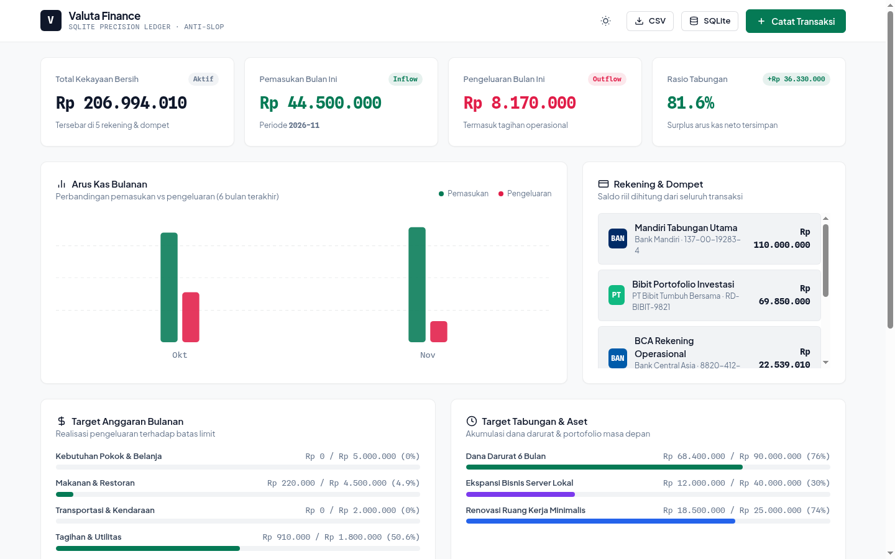
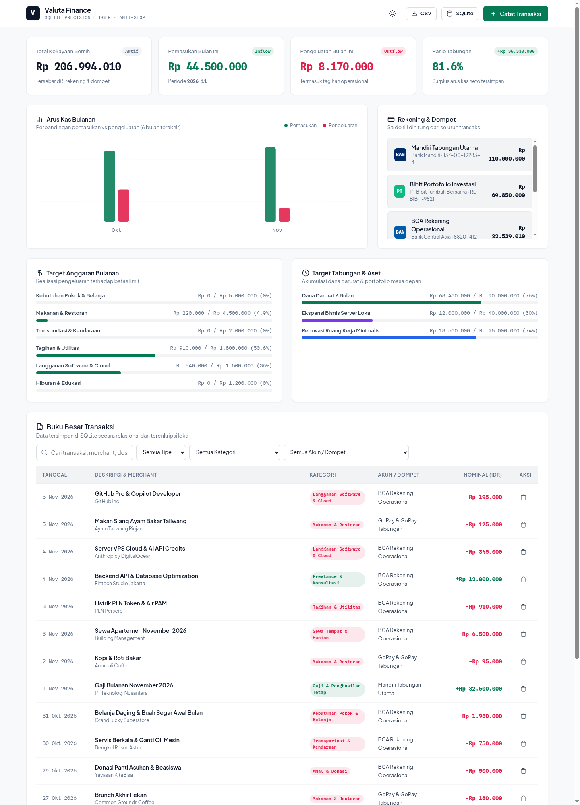
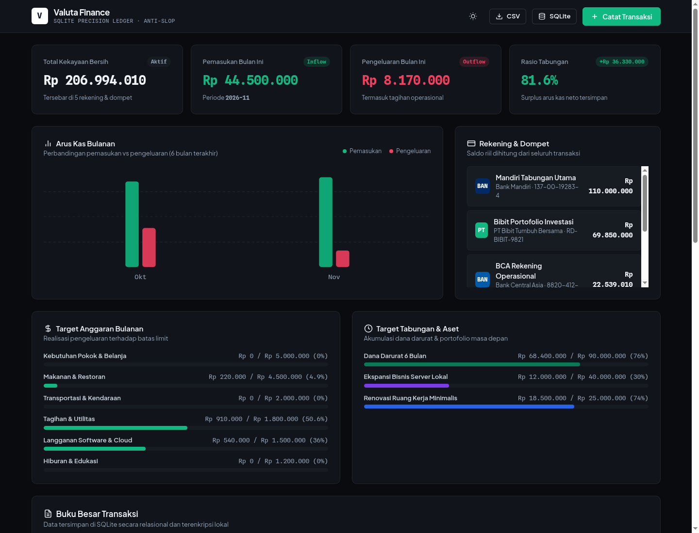
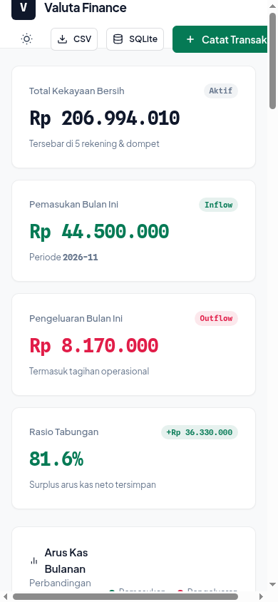
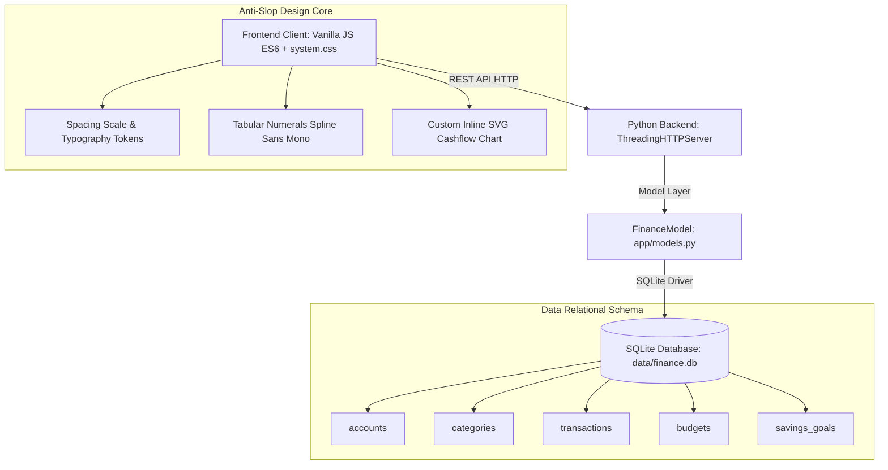

# Valuta — Precision Financial Dashboard OS (SQLite)

> Website Dashboard Keuangan Modern, Cepat, dan Presisi dengan SQLite Backend — Dirancang dengan standar **Anti-Slop Design** (Leonxlnx/taste-skill), tipografi editorial/fintech kelas dunia (Linear/Mercury standard), dan arsitektur data lokal yang aman.



---

## 🌟 Fitur Unggulan

- **SQLite Database Engine (WAL Mode)**:
  - Database relasional lokal tanpa dependensi cloud pihak ketiga yang berat.
  - Zero-latency query: agregasi saldo akun, kalkulasi arus kas bulanan, dan audit riwayat transaksi secara instan.
  - Relational schema lengkap: `accounts`, `categories`, `transactions`, `budgets`, `savings_goals`.
- **Anti-Slop Design System (Taste Skill Standard)**:
  - Dibangun berdasarkan prinsip ketat `Leonxlnx/taste-skill`:
    - 90–95% neutral foundation (tanpa gradient ungu AI-slop, tanpa border glow neon generic, tanpa card mengambang hampa).
    - Tipografi kelas tinggi: `Plus Jakarta Sans` dengan `Spline Sans Mono` tabular numbers (`font-variant-numeric: tabular-nums`) untuk presisi nominal moneter.
    - Equal edges container (`.wrap`) dengan ritme spasi baku `--s-1` hingga `--s-9`.
    - Micro-interactions tenang: card lift 2px, button step & press, SVG vector graphics.
- **Dua Tema Eksklusif**:
  - **Light Mode (Default)**: Warm Crisp Slate (`#f8f9fa`) dengan border hairline (`rgba(15,23,42,0.08)`).
  - **Dark Mode**: Bespoke Graphite Slate (`#090b0e`) dengan aksen emerald (`#10b981`). Toggleable via header atau parameter URL `?theme=dark`.
- **Multi-Account & Digital Wallets Ledger**:
  - Saldo riil dihitung secara live dari seluruh mutasi (Pemasukan, Pengeluaran, Transfer Antar Akun).
  - Terintegrasi dengan entitas institusi: Bank Mandiri, Bank Central Asia (BCA), GoPay / GoTo Financial, Bibit Portofolio Reksadana/Saham, serta Kas Tunai.
- **Arus Kas Bulanan (SVG Interactive Bar Chart)**:
  - Visualisasi perbandingan pemasukan vs pengeluaran 6 bulan terakhir tanpa library external yang membengkak.
- **Budgeting & Savings Targets Tracker**:
  - Realisasi belanja terhadap kuota bulanan per kategori (Makanan, Belanja Pokok, Transportasi, Langganan Cloud, Utilitas).
  - Indikator progres target tabungan (Dana Darurat 6 Bulan, Renovasi, Ekspansi Bisnis).
- **Full REST API & Realtime CRUD**:
  - Catat transaksi baru dengan modal drawer interaktif.
  - Live search dengan debounce 250ms, filter kategori, tipe, dan akun.
  - Ekspor instan ke CSV dan unduh snapshot backup database `.db` langsung dari UI.

---

## 📸 Tampilan Visual

### 1. Desktop Full View (Light Theme)


### 2. Bespoke Dark Mode (Graphite Slate)


### 3. Mobile Responsive View (390x844)


---

## 🏛️ Arsitektur Sistem



---

## 🚀 Panduan Menjalankan

### Prasyarat
- Python 3.10+ (Sudah terpasang di Linux / Termux / MacOS / Windows)
- Browser modern (Chromium, Chrome, Edge, Firefox, Safari)

### 1. Clone & Masuk Direktori
```bash
git clone https://github.com/faridmarufprabowo2021/keuangan-sqlite-dashboard.git
cd keuangan-sqlite-dashboard
```

### 2. Jalankan Server
```bash
python3 server.py
```

### 3. Akses di Browser
Buka browser pada alamat:
```text
http://localhost:8090
```
Untuk mengaktifkan tema gelap langsung:
```text
http://localhost:8090/?theme=dark
```

---

## 📡 Dokumentasi Endpoint REST API

| Method | Endpoint | Deskripsi |
|---|---|---|
| `GET` | `/` | Antarmuka Dashboard Web Utama |
| `GET` | `/api/summary` | Ringkasan eksekutif (Kekayaan bersih, inflow, outflow, rasio tabungan) |
| `GET` | `/api/accounts` | Daftar akun/dompet dengan kalkulasi saldo live |
| `POST` | `/api/accounts` | Membuat akun/rekening baru |
| `GET` | `/api/categories` | Daftar kategori pemasukan & pengeluaran |
| `GET` | `/api/transactions` | Query transaksi (`search`, `type`, `category_id`, `account_id`, `page`, `limit`) |
| `POST` | `/api/transactions` | Menyimpan transaksi baru |
| `PUT` | `/api/transactions/<id>` | Memperbarui data transaksi |
| `DELETE` | `/api/transactions/<id>` | Menghapus transaksi |
| `GET` | `/api/budgets` | Status realisasi anggaran bulanan per kategori |
| `POST` | `/api/budgets` | Menetapkan batas kuota anggaran |
| `GET` | `/api/savings` | Daftar target tabungan & progres capaian |
| `GET` | `/api/analytics/cashflow` | Data agregat time-series arus kas bulanan |
| `GET` | `/api/export/csv` | Download file CSV mutasi transaksi |
| `GET` | `/api/export/db` | Download file mentah backup database SQLite |
| `POST` | `/api/seed` | Reset / re-seed data keuangan realistis |

---

## 🛡️ Standar Kualitas & Taste-Skill
Proyek ini mengadopsi standar **taste-skill** (`Leonxlnx/taste-skill`):
- Bebas dari klise "AI Slop" (tanpa border glow ungu/neon, tanpa layout template bootstrap yang kaku).
- Data keuangan dibuat realistis mencerminkan ekosistem perbankan & transaksi Indonesia (BCA, Mandiri, GoPay, Bibit, dsb).
- Telah diverifikasi visual melalui Chromium Headless pada viewport desktop (1440x900, 1440x2000) dan mobile (390x844).

Lisensi: MIT. Dibuat dengan dedikasi tinggi untuk rekayasa perangkat lunak finansial presisi.
